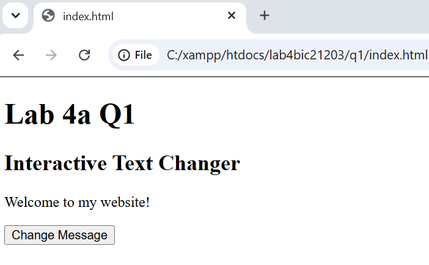
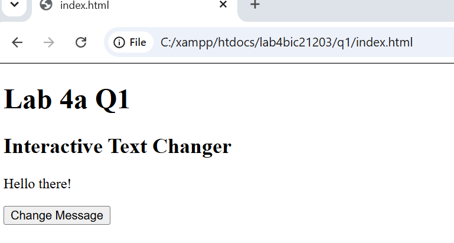
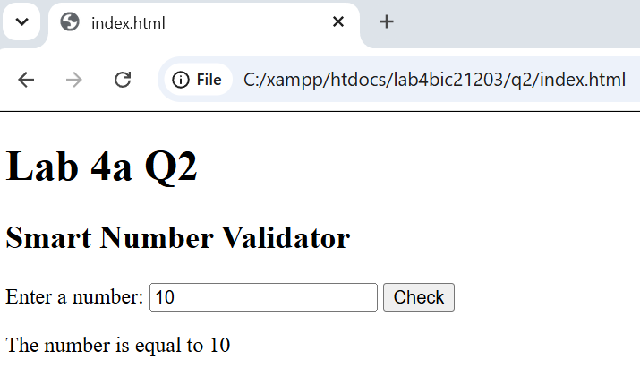
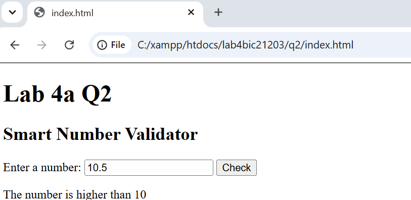
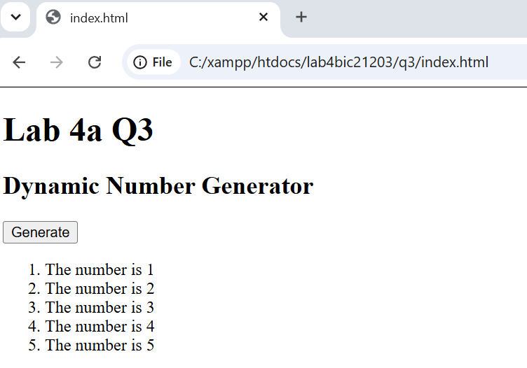

# BIC21203 Web Development — Lab #4a

**Student Name:** Peggy Chua Pei Yee  
**Matric No:** AI240179  
**Session:** 2026/2027 

---

## Overview
- **Q1 (Text Changer):** Uses DOM selection, an external script with `defer`, and `addEventListener()` to safely update text to "Hello there!" via `textContent`[cite: 10].
- **Q2 (Smart Validator):** Validates input with `trim()` and `isNaN()`, supporting decimals (e.g., 10.5) and filtering non-numbers/empty inputs via `if...else if...else`[cite: 10].
- **Q3 (Number Generator):** Uses a `for` loop (1 to 5) and `document.createElement()` to append list items, clearing prior nodes first to prevent duplicates on repeated clicks[cite: 10].

---

## Instructions to Run
1. Open the subfolder for any task (`q1/`, `q2/`, or `q3/`)[cite: 10].
2. Double-click `index.html` to run in any browser, or right-click and select **Open with Live Server** in VS Code[cite: 2, 10].

---

## Output Screenshots

### Question 1
- **Initial:**  
  
- **Clicked:**  
  

### Question 2
- **Valid Tests (5 / 10 / 15):**  
  
- **Edge Cases (10.5 / abc / Empty):**  
  

### Question 3
- **List 1 to 5 (No Duplicates on Repeat Clicks):**  
  